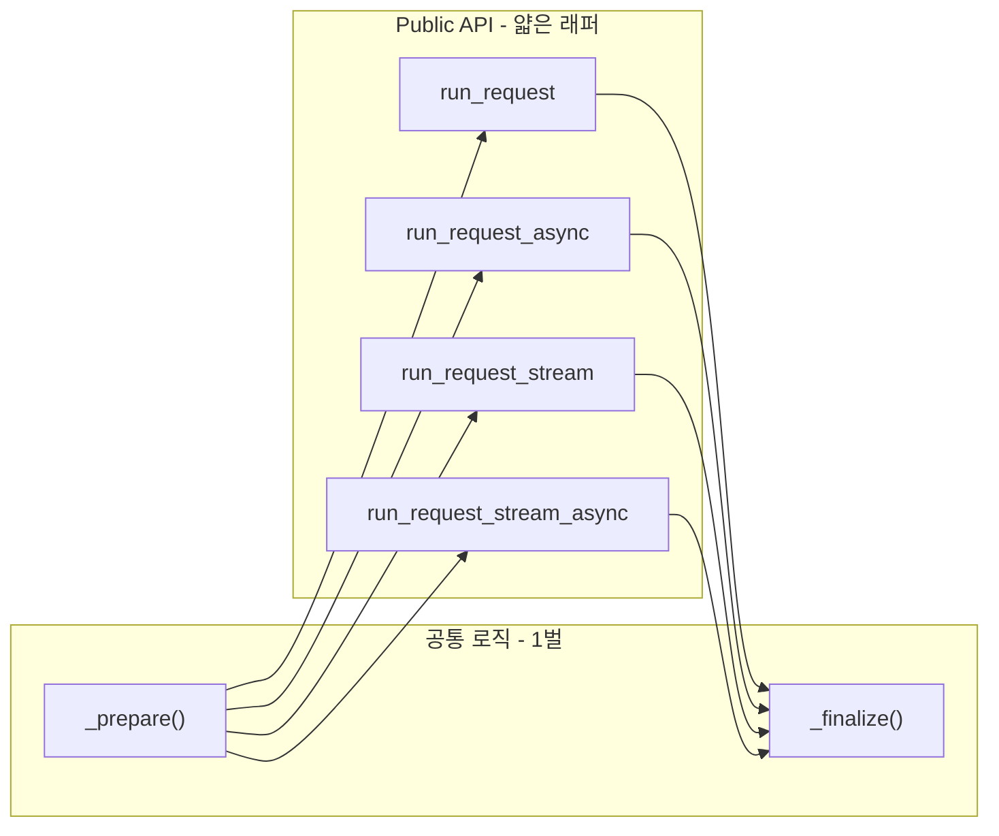
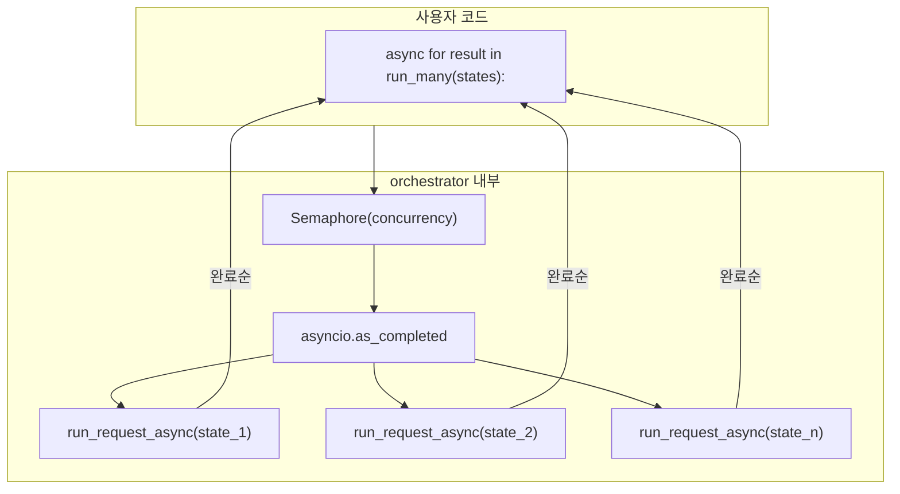

# LLM Worker Architecture Plan

## 현재 상태

- [runner.py](runner.py): `run_request` (async only), 캐시/저장/LLM 호출 로직이 하나에 섞여있음
- [llm_handler](../llm_handler/): sync(`__init__.py`) / async(`aio.py`) 각각 별도 구현, 공통 로직은 `_common.py`의 `build_body`로 분리
- 현재 `llm_worker`에는 async call만 존재하고, sync/stream/multi는 없음

---

## 병렬 처리 배경: 왜 async인가

### 기존 에이전트(RM, ESG)의 병렬 처리

기존 에이전트는 `genai`(sync) + Oracle DB(`winus_handler`, sync) 등 **전체 의존성 체인이 sync**이다.
sync 함수를 async FastAPI 라우터에서 병렬 실행하기 위해 접착제가 필요하다:

- `ThreadPoolExecutor`: sync 함수를 별도 스레드에서 실행
- `loop.run_in_executor()`: sync → async 브릿지
- `queue.Queue()`: 스레드 ↔ async 이벤트 루프 간 진행률 전달

이 구조는 "sync 코드를 async 세계에 억지로 끼워넣는 우회"이며, 코드가 복잡해지는 원인이다.

### llm_worker의 접근: async native

`llm_handler` SDK는 HTTP 기반(`httpx.AsyncClient`)이므로 LLM 호출이 **처음부터 async**이다.
`done_check` → `cache_get`은 MongoDB sync 호출이지만, 캐시 조회 1회(수 ms)라 이벤트 루프 블로킹 영향이 무시 가능하다.

따라서 `ThreadPoolExecutor`, `queue.Queue`, `run_in_executor` 없이
**`asyncio.Semaphore` + `asyncio.as_completed`** 만으로 병렬 처리가 가능하다.

### DB가 sync여도 async LLM 호출이 가능한 이유

에이전트의 전형적 흐름에서 병목은 LLM 호출(2~30초)이지, DB 조회(수 ms)가 아니다.

```python
# 1. sync DB 조회 (수 ms, 블로킹해도 무시 가능)
fund_data = query_to_dataframe("SELECT ...")

# 2. 데이터 가공 (sync, 수 ms)
prompt = build_prompt(fund_data)

# 3. LLM 호출 (async, 여기가 병목 -- await로 이벤트 루프에 양보)
result = await run_request_async({"llm_input": {"input": prompt, ...}})
```

sync DB 호출이 이벤트 루프를 수 ms 블로킹하지만, LLM의 수 초 대비 무시할 수 있는 수준이다.
**에이전트의 DB가 sync여도 LLM 호출은 async로 처리할 수 있다.**

### asyncio.gather vs asyncio.as_completed

| | `asyncio.gather` | `asyncio.as_completed` |
|---|---|---|
| 반환 시점 | 전부 끝나야 한꺼번에 반환 | 하나 끝날 때마다 즉시 반환 |
| 반환 순서 | 입력 순서 보장 | 완료순 (순서 보장 안 됨) |
| SSE 스트리밍 | 불가 (전부 끝날 때까지 응답 없음) | 가능 (하나씩 yield) |

`run_many`는 SSE 실시간 전송과 "먼저 끝난 것부터 처리" 패턴을 위해 `as_completed`를 사용한다.

---

## 코드 스타일 전략: 2단계 접근

### 1차 (개발 단계): prepare/finalize 패턴 -- 유지보수 우선

로직이 자주 바뀌는 시기이므로, 비즈니스 로직을 `_prepare()` + `_finalize()`에 1벌만 작성.
4개 public 함수는 LLM 호출 방식만 다른 3-4줄 래퍼로 구성한다.
로직 수정 시 1곳만 고치면 4개 함수에 모두 반영되므로 개발 중 변경 비용이 낮다.

### 최종 (안정화 후): 가독성 우선 리팩토링

로직이 확정되면, 각 함수에 로직을 인라인으로 풀어서 중복이더라도 **독립적으로 읽히는 코드**로 전환.
현재 `llm_handler`의 `_sync_client.py` / `_client.py` 스타일과 동일.
이 시점에서는 로직 변경이 드물기 때문에 중복 유지보수 비용이 낮고, 가독성 이점이 더 크다.



### _prepare(state, \*, database) -> _Prepared

캐시 조회 + 메타 준비. LLM 호출 전까지의 모든 로직 담당.

```python
@dataclass
class _Prepared:
    llm_input: dict
    meta: dict
    cache_mode: bool
    save_mode: bool
    ttl_seconds: int | None
    debug: bool
    dc: DoneCheckResult | None
    cached_output: tuple[LLMResponse, dict] | None  # None이면 cache miss
    route_reason: str | None
```

### _finalize(prep, llm_result, \*, database) -> tuple[LLMResponse, dict]

LLM 응답 저장 + `(LLMResponse, meta)` 튜플 반환. `save_mode=True`면 `save_result` 호출.

### Public 함수 (예: run_request_async)

```python
async def run_request_async(state, *, database=None) -> tuple[LLMResponse, dict]:
    prep = _prepare(state, database=database)
    if prep.cached_output:
        return prep.cached_output
    res = await aio_call(**prep.llm_input)
    return _finalize(prep, res, database=database)
```

로직 수정 시 `_prepare`/`_finalize`만 고치면 4개 함수에 모두 반영된다.

---

## Phase 1 (1차 구현): Non-stream 단일 + 다중 handler -- prepare/finalize 패턴

### 1-1. runner.py 리팩토링

- 기존 `run_request` -> `run_request_async`로 rename
- `_prepare()`, `_finalize()` 추출
- sync 버전 `run_request` 추가 (llm_handler.call 사용)

**파일 변경**: [runner.py](runner.py), [\_\_init\_\_.py](__init__.py)

**네이밍 컨벤션**:

- `run_request` -- sync call (기본, 가장 단순)
- `run_request_async` -- async call
- `run_request_stream` -- sync stream (2차)
- `run_request_stream_async` -- async stream (2차)

### 1-2. orchestrator.py 신규 생성

다중 handler. 내부적으로 `run_request_async`를 활용.

**핵심 메커니즘**: `asyncio.as_completed` + `asyncio.Semaphore`



#### run_many -- 병렬 실행, 완료순 반환, _index로 순서 관리

```python
async def run_many(
    states: Iterable[dict],
    *,
    concurrency: int = 5,
    database: str | None = None,
) -> AsyncIterator[dict]:
```

**동시 실행 수 제어**: `concurrency` 파라미터로 `Semaphore`를 생성한다.
100개 state를 넣어도 동시에 `concurrency`개만 실행되고, 하나가 끝나면 다음이 자동 투입된다.

**순서 관리**: `as_completed`는 완료순으로 반환하므로 입력 순서가 보장되지 않는다.
각 결과에 `_index`(입력 순서 int)와 `_state`(원본 state 참조)를 첨부하여 호출자가 식별/정렬할 수 있게 한다.

```python
async def run_many(states, *, concurrency=5, database=None):
    sem = asyncio.Semaphore(concurrency)

    async def _worker(idx: int, state: dict) -> tuple[LLMResponse, dict]:
        async with sem:
            response, meta = await run_request_async(state, database=database)
            meta["_index"] = idx
            meta["_state"] = state
            return response, meta

    tasks = [asyncio.create_task(_worker(i, s)) for i, s in enumerate(states)]
    for coro in asyncio.as_completed(tasks):
        yield await coro
```

사용 예:

```python
async for response, meta in run_many(states, concurrency=10):
    print(f"[{meta['_index']}] {meta['_state']['fund_code']} 완료")
    print(response.text)
```

입력 순서대로 정렬이 필요하면:

```python
all_results = [(r, m) async for r, m in run_many(states)]
all_results.sort(key=lambda x: x[1]["_index"])
```

#### 실시간 결과 수신

- **`async for` (AsyncIterator)** -- 주 인터페이스. 가장 Pythonic하고 직관적
- `run_many`는 건 단위 진행률("N개 중 M개 완료")을 자연스럽게 제공
- 건 내부 단계별 진행률은 `run_many`의 범위 밖 (에이전트 레벨에서 처리)

---

## 에이전트 적용 시나리오

### 패턴 A: 단순 N건 병렬 -- `run_many` 사용

**적합**: 펀드당 LLM 호출 1번, state를 미리 만들 수 있는 경우

```python
# 1. 전체 데이터 준비 (sync DB, 빠름)
states = []
for code in fund_codes:
    data = query_to_dataframe("SELECT ... WHERE code = :1", [code])
    prompt = build_prompt(data)
    states.append({"llm_input": {"input": prompt, ...}, "fund_code": code})

# 2. 병렬 LLM 호출
async for response, meta in run_many(states, concurrency=10):
    parsed = parse_response(response.text)
    save(meta["_state"]["fund_code"], parsed)
```

**해당 에이전트**:

- **RM 코멘트 생성(Preview)**: `generate_risk_comment`이 펀드당 LLM 1번 호출.
  DB 조회로 프롬프트 재료를 준비한 뒤 states를 모아서 `run_many`로 병렬 호출 가능.
- **ESG 평가**: DP당 LLM 1번 호출. 프롬프트가 이미 준비된 상태.
  현재 `ThreadPoolExecutor`를 `run_many`로 대체 가능. (단, genai → llm_handler 전환 필요)

### 패턴 B: 복합 파이프라인 -- `run_request_async` 직접 사용

**적합**: 펀드당 LLM 호출 N번, 이전 LLM 결과에 다음 호출이 의존하는 경우

```python
async def evaluate_fund(fund_code: str) -> dict:
    # 1. sync DB 조회 (수 ms)
    data = query_to_dataframe("SELECT ... WHERE code = :1", [fund_code])

    # 2. LLM #1: 분류 (await로 이벤트 루프에 양보)
    r1, m1 = await run_request_async({"llm_input": {"input": classify_prompt(data), ...}})

    # 3. 중간 처리 (sync, 수 ms)
    next_prompt = build_eval_prompt(r1.text, data)

    # 4. LLM #2: 평가 (await로 또 양보)
    r2, m2 = await run_request_async({"llm_input": {"input": next_prompt, ...}})

    # 5. 등급 산출 (sync)
    return calculate_grade(r2)

# 여러 펀드 동시 실행 (에이전트가 직접 Semaphore + as_completed 구성)
sem = asyncio.Semaphore(10)

async def limited(code):
    async with sem:
        return await evaluate_fund(code)

tasks = [asyncio.create_task(limited(c)) for c in fund_codes]
for coro in asyncio.as_completed(tasks):
    result = await coro
    # SSE 전송 등
```

**해당 에이전트**:

- **RM 위험등급 산정**: 펀드당 LLM 여러 번 순차 호출 (분류 → 정성 → 검증).
  각 LLM 호출을 `await run_request_async()`로 교체하면 구조 변경 최소화.
  여러 펀드 동시 실행은 에이전트가 `Semaphore` + `as_completed`로 직접 구성.
  `ThreadPoolExecutor` + `queue.Queue` 제거 가능.

### 패턴 비교

| | 패턴 A: run_many | 패턴 B: run_request_async 직접 |
|---|---|---|
| 펀드당 LLM 호출 | 1번 | N번 (순차) |
| state 준비 | 미리 전부 생성 가능 | 이전 LLM 결과에 의존 |
| 병렬 제어 | run_many 내장 | 에이전트가 Semaphore 직접 구성 |
| 진행률 | run_many yield로 건 단위 | 에이전트 코드에서 자유롭게 |
| 보일러플레이트 | 최소 (1줄) | 약간 (Semaphore + as_completed) |

---

## 출력 양식 통일: 튜플 반환

### 배경

기존 `llm_worker`는 `dict`를 반환하여 `result["result"].text` 같은 접근이 필요했다.
`llm_handler`가 `LLMResponse`를 직접 반환하는 것과 사용 패턴이 달라 학습 비용이 발생한다.

반환 형태를 `(LLMResponse, meta)` 튜플로 통일하면:
- `llm_handler`와 동일하게 `response.text`로 직접 접근
- 메타 정보(cache_hit, cache_key 등)는 두 번째 원소로 분리
- stream 함수는 캐시 히트/미스 관계없이 항상 `(Iterator[StreamChunk], meta)` 반환

### 설계 결정 사항

| 항목 | 선택지 | 결정 | 이유 |
|------|--------|------|------|
| 메타 반환 방식 | **A: 튜플** / B: NamedTuple/dataclass / C: LLMResponse 확장 | **A** | 단순. `response, meta = run_request(state)` |
| stream 캐시 히트 | **A: Iterator 통일** — 캐시 텍스트를 StreamChunk 1개로 감싸기 / B: 분기 유지 | **A** | `isinstance` 분기 제거. stream 함수는 항상 동일한 타입 반환 |
| run_many | **A: 튜플** — yield `(LLMResponse, meta)`, meta에 `_index`, `_state` 포함 / B: dict 유지 | **A** | 단일 함수와 동일한 패턴 |
| run_many_stream | 이벤트 dict 유지하되, `cache_hit` 이벤트의 `data`를 `(LLMResponse, meta)` 튜플로 변경 | — | 이벤트 프로토콜은 유지하면서 내부 데이터만 튜플화 |

### 반환 타입 정리

| 함수 | 반환 타입 |
|------|----------|
| `run_request` | `tuple[LLMResponse, dict]` |
| `run_request_async` | `tuple[LLMResponse, dict]` |
| `run_request_stream` | `tuple[Iterator[StreamChunk], dict]` |
| `run_request_stream_async` | `tuple[AsyncIterator[StreamChunk], dict]` |
| `run_many` | `AsyncIterator[tuple[LLMResponse, dict]]` |
| `run_many_stream` | `AsyncIterator[dict]` (이벤트 프로토콜 유지) |

### meta dict 구조

```python
{
    "source": "live" | "cache",
    "cache_hit": bool,
    "cache_key": str | None,
    "meta": dict,              # service_name, model, provider 등
    "collection": str | None,
    # debug=True일 때만:
    "route_reason": str,
    # run_many 전용:
    "_index": int,
    "_state": dict,
}
```

### 사용 예

```python
# call
response, meta = run_request(state)
response.text                    # LLMResponse 직접 접근
meta["cache_hit"]                # 메타

# stream (캐시 히트든 미스든 동일)
stream, meta = run_request_stream(state)
for chunk in stream:
    print(chunk.text, end="")

# run_many
async for response, meta in run_many(states, concurrency=10):
    print(f"[{meta['_index']}] {response.text}")
```

---

## Phase 2 (2차 구현): Stream 확장

### 설계 결정 사항

| 항목 | 선택지 | 결정 | 이유 |
|------|--------|------|------|
| 캐시 히트 시 동작 | **A: 캐시 텍스트를 StreamChunk 1개로 yield** / ~~B: 완성된 dict 반환~~ / C: 캐시 조회 안 함 | **A** (변경) | 출력 양식 튜플 통일에 따라 항상 `(Iterator, meta)` 반환으로 변경. isinstance 분기 제거 |
| 저장 시점 | **A: 완료 후 1회 저장** / B: 저장 안 함 | **A** | stream 완료 후 누적 텍스트를 LLMResponse로 조립하여 1회 저장 |
| yield 타입 | **A: StreamChunk 그대로** / B: dict로 감싸기 | **A** | llm_handler.stream과 동일한 타입으로 단순하게 유지 |
| 에러 시 partial | **A: 버림** / B: partial 저장 | **A** | 단순. 나중에 중간 저장 필요 여부는 실사용 후 재검토 |

### _finalize_stream 설계 결정 사항

| 항목 | 선택지 | 결정 | 이유 |
|------|--------|------|------|
| request_id | **A: 빈 문자열 ""** / B: "stream" 표식 / C: llm_handler 수정하여 실제 값 획득 | **A** | StreamChunk에 request_id 필드가 없으므로 비워둠 |
| usage/finish_reason 추출 | **A: 마지막 chunk에서 추출** / B: 전체 순회하여 None 아닌 값 탐색 / C: 저장 안 함 | **A** | SSE 프로토콜 표준 패턴 — 마지막 chunk에만 담김 |
| 저장 형태 | A: LLMResponse 호환 dict만 / **B: LLMResponse 호환 dict + source: "stream"** | **B** | MongoDB 직접 조회 시 stream/call 구분 가능. Pydantic v2가 extra field 무시하므로 캐시 복원에 영향 없음 |

### 2-1. stream 단일 handler

- `run_request_stream(state) -> tuple[Iterator[StreamChunk], dict]`
- `run_request_stream_async(state) -> tuple[AsyncIterator[StreamChunk], dict]`

**캐시 히트/미스 관계없이 항상 동일한 타입**을 반환한다.
캐시 히트 시에는 캐시된 텍스트를 StreamChunk 1개로 감싸서 Iterator로 반환한다.

```python
stream, meta = run_request_stream(state)
for chunk in stream:            # 캐시 히트든 미스든 동일한 코드
    print(chunk.text, end="")
print(f"\ncache_hit: {meta['cache_hit']}")
```

**캐시 미스 시**: `StreamChunk`를 그대로 yield한다.
내부 accumulator가 전체 텍스트를 누적하고, stream 완료 후 `_finalize_stream`으로 1회 저장한다.

```python
async def run_request_stream_async(state, *, database=None):
    prep = _prepare(state, database=database)
    if prep.cached_output:
        response, meta = prep.cached_output
        async def _cached():
            yield StreamChunk(text=response.text, finish_reason=response.finish_reason, usage=response.usage)
        return _cached(), meta
    
    async def _stream():
        accumulated = []
        async for chunk in aio_stream(**prep.llm_input):
            accumulated.append(chunk)
            yield chunk
        _finalize_stream(prep, accumulated, database=database)
    
    return _stream(), _build_live_meta(prep)
```

### 2-2. stream 다중 handler (`run_many_stream`)

#### 설계 결정 사항

| 항목 | 선택지 | 결정 | 이유 |
|------|--------|------|------|
| yield 형태 | **A: dict에 StreamChunk 객체 그대로** / B: flat dict로 펼침 | **A** | chunk.text, chunk.usage 등 원본 접근 유지 |
| 캐시 히트 처리 | **A: `_type: "cache_hit"`으로 `(LLMResponse, meta)` 튜플 1회 yield** / B: chunk 1개로 감싸서 통일 | **A** | 캐시 히트는 chunk 없이 완전한 결과를 즉시 전달. data는 튜플 형태 |
| 완료 신호 | **A: `_type: "done"` 이벤트 yield** / B: 없음 | **A** | 호출자가 각 요청의 완료 시점을 알 수 있음 |

#### 이벤트 타입

모든 이벤트에 `meta` 가 포함된다. 이벤트 타입에 관계없이 `event["meta"]`로 메타 정보에 접근 가능.
(같은 요청의 chunk/done은 동일한 meta dict 참조를 공유하므로 메모리 오버헤드 없음)

- `{"_index": int, "_type": "chunk", "chunk": StreamChunk, "meta": dict}` — stream 텍스트 조각
- `{"_index": int, "_type": "done", "meta": dict}` — 해당 index의 stream 완료
- `{"_index": int, "_type": "cache_hit", "data": (LLMResponse, meta), "meta": dict}` — 캐시 히트, 완성 결과 튜플
- `{"_index": int, "_type": "error", "error": Exception, "meta": dict}` — 해당 index 에러 발생

#### 구조

- `asyncio.Queue`를 채널로 사용하여 N개 worker의 chunk를 병합
- `asyncio.Semaphore`로 동시 실행 제한 (기존 `run_many`와 동일 패턴)
- 각 worker는 `run_request_stream_async` 호출 후 `meta["cache_hit"]`로 캐시 히트 분기
- 모든 worker 완료 후 sentinel을 넣어 메인 루프 종료

```python
async for event in run_many_stream(states):
    if event["_type"] == "chunk":
        print(f"[{event['_index']}] {event['chunk'].text}", end="")
        print(f"  source={event['meta']['source']}")
    elif event["_type"] == "done":
        print(f"\n[{event['_index']}] 완료 (cache_hit={event['meta']['cache_hit']})")
    elif event["_type"] == "cache_hit":
        response, meta = event["data"]
        print(f"[{event['_index']}] 캐시: {response.text}")
    elif event["_type"] == "error":
        print(f"[{event['_index']}] 에러: {event['error']}")
```

### 2-3. 에러 처리

- stream 중간 에러 시: **partial 결과를 버린다** (저장하지 않음)
- 나중에 실사용 중 중간 저장이 필요해지면 `error_partial` 플래그 추가를 재검토
- retry 정책: 단일에서는 caller 책임, 다중에서는 orchestrator 레벨 retry 옵션

---

## 파일 구조 (최종)

```
llm_worker/
  __init__.py          # public exports
  runner.py            # _prepare, _finalize, _finalize_stream, run_request, run_request_async, run_request_stream, run_request_stream_async
  orchestrator.py      # run_many, run_many_stream
  done_check.py        # 변경 없음
  keying.py            # 변경 없음
  store.py             # 변경 없음
  meta.py              # 변경 없음
  DESIGN.md            # 이 설계 문서
```

---

## 구현 순서 정리

- ~~1차-1: runner.py prepare/finalize 분리 + sync 추가 (runner.py)~~
- ~~1차-2: \_\_init\_\_.py export 업데이트 (\_\_init\_\_.py)~~
- ~~1차-3: orchestrator.py: run_many (orchestrator.py 신규)~~
- ~~1차-4: quickstart_worker.ipynb 업데이트 (quickstart_worker.ipynb)~~
- ~~2차-1: stream 단일 handler 추가 (runner.py)~~
- ~~2차-2: stream finalize 로직 (runner.py)~~
- ~~2차-3: stream multi (orchestrator.py)~~
- ~~2.5차-1: runner.py 반환 타입을 튜플로 변경 (runner.py)~~
- ~~2.5차-2: orchestrator.py 반환 타입을 튜플로 변경 (orchestrator.py)~~
- ~~2.5차-3: quickstart_worker.ipynb / README_worker.md / 테스트 노트북 업데이트~~
- ~~2.5차-4: run_many_stream 모든 이벤트에 meta 포함 (orchestrator.py)~~

## Phase 3 (최종): 가독성 리팩토링 -- stream까지 전부 완료 후, 별도 요청 시 진행

> 이 단계는 1차/2차(stream 포함) 구현이 모두 안정화된 뒤, 사용자가 "풀자"라고 요청할 때 실행한다.
> todo에 포함하지 않음.

- `_prepare` / `_finalize`를 각 public 함수에 인라인으로 풀기
- 각 함수가 독립적으로 전체 흐름을 보여주는 구조로 전환
- llm_handler의 `_sync_client.py` / `_client.py` 스타일과 동일한 형태
- 이 시점에서 `_Prepared` dataclass, `_prepare()`, `_finalize()` 제거
